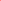

# Getting started (MathExamHub)

This guide walks through the recommended first session: **sample bank import → exam wizard → LaTeX export**.

## First login

After you register or log in, a **快速上手** panel appears at the bottom of the screen.

1. Click **一键导入示例题库** to load the rich sample bank (44 questions, knowledge-point tree, starter blueprint template) into your personal bank (skipped if you already imported it).
2. Follow the tour steps to open **LaTeX 导入**, **组卷向导**, and **LaTeX 导出**.
3. Click **完成** to dismiss the tour (stored on your user profile).

API (optional):

- `POST /api/onboarding/import-sample` (requires `X-Bank-Id` and write access)
- `PATCH /api/onboarding/tour` with `{ "tourStep": 2 }` or `{ "tourCompleted": true }`

## Demo path

| Step | Route | What to try |
|------|--------|-------------|
| Import | `/latex-import` | Upload `.tex` or use the onboarding sample |
| Wizard | `/exam-wizard` | Save blueprint → **检查题库覆盖** (try 8 seeds) → generate |
| Export | `/latex-export` or wizard step 3 | Export mathexam ZIP with answer sheet |
| Stats | `/bank-stats` | Charts + CSV with blueprint gap filter columns |

## Screenshots

Screenshots are captured by the Playwright smoke test (`npm --prefix e2e test` with backend + frontend running; see CI `e2e-smoke` job).

## Related docs

- [LaTeX import/export](./LaTeX_IMPORT_EXPORT.md)
- [Deployment (NAS/Docker)](./DEPLOYMENT_NAS.md)
- [Roadmap](./ROADMAP.md)
