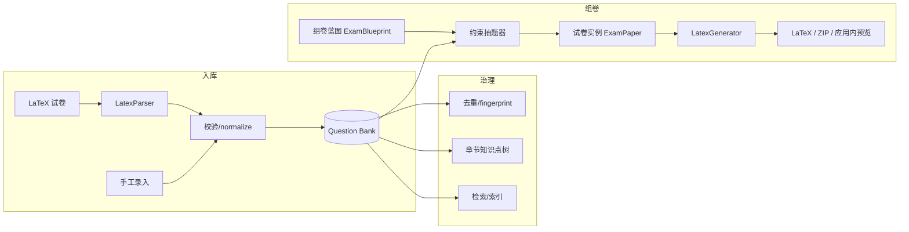

# MathExamHub 演进路线图

> **文档性质**：基于 2026-10 代码库审计的产品与技术路线图。  
> **目标**：从「手工维护 + 手动组卷导出」演进为「可治理的数学题库 + 约束驱动的自动组卷」。  
> **范围说明**：本文件只描述规划与验收标准；实现按下方里程碑拆成多个独立 PR。

---

## 1. 愿景与边界

### 1.1 目标能力

| 能力域 | 目标 |
|--------|------|
| **题库管理** | 题目全生命周期：导入、校验、去重、打标、检索、版本与引用追踪 |
| **自动组卷** | 按科目/题型/难度（易/中/难）/分值/章节知识点等约束抽题，支持随机化、多卷（A/B）、试卷与答案分离输出 |
| **输出** | `mathexam` LaTeX（与现有宏包一致）+ **应用内预览**（MathJax/题干渲染）；不在服务端编译 PDF |
| **治理** | 认证授权、审计日志、可重复的测试与 CI |

### 1.2 非目标（近期不做）

- 在线答题、自动阅卷（除导出标准答案卷外）
- 替换现有 `mathexam` 宏包或全面支持任意 LaTeX 模板
- 大规模 LLM 自动生成全新题目（可列为远期实验）
- 服务端 PDF/XeLaTeX 编译（**已明确不做**；见 §6.1；原 M12 降为 backlog，非近期目标）

> **分支说明**：审计时参考了 `feature/latex-import-export` 上的完整功能；**自 2026-10 起以 `main` 为合并基线**，功能差异将在后续里程碑中合入。

---

## 2. 现状审计摘要

### 2.1 技术栈

| 层级 | 技术 |
|------|------|
| 后端 | Node.js 18、Express 4、Mongoose 8、MongoDB |
| 前端 | Vue 3、Vue Router、Bootstrap 5、axios、MathJax（vue-mathjax-next） |
| 部署 | Docker Compose、PM2、Nginx 反向代理 |
| 桌面 | Electron 壳（极简，未对接 dev server / 打包流程） |
| LaTeX | 仓库内 `TeX/mathexam.sty` + `backend/utils/latexParser.js`（解析/生成） |

### 2.2 数据模型（`Question`）

当前字段（`backend/models/Question.js`）：

- **题干**：`questionText`（导入后多为含 `<image>` / `<a>` 的中间表示，非纯 LaTeX）
- **原始 LaTeX**：`originalLaTeX`（可选，导出时优先使用）
- **选项**：`options.A–D`（选择题）
- **答案**：`correctAnswer`（`Mixed`，题型不同结构不同）
- **元数据**：`type`（枚举 9 种中文题型）、`subject`（自由文本）、`totalScore`、`difficulty`（将统一为 **易 / 中 / 难** 三档文本）、`createdBy`、`createdAt` / `updatedAt`

**缺失（相对「题库系统」预期）**：

- **章节/知识点树**（非扁平 tags）
- 题目状态（草稿、已发布、作废）
- 内容指纹（hash）与引用关系（来源试卷、使用次数）
- 数据库索引（文档中建议的 `tags` 索引未落地）

### 2.3 已实现且基本可用的功能

- **CRUD**：创建、按 ID 获取、按字段增量更新、删除、列表与简单筛选（科目、题型、题干 regex）
- **搜索**：`/questions/search`（多关键词 AND；依赖 `questionText` 非空，否则可能 500）
- **LaTeX 导入**：预览 + 正式导入；`mathexam` 的 `makepart` / `problem`；图片/PDF 重命名与 `uploads` 存储
- **LaTeX 导出**：按选中 ID 组卷，zip 打包 tex + 图片；`LatexGenerator` 按题型分段
- **去重（算法层）**：`duplicateDetector.js`（归一化 + 相似度）；导入时可选跳过；列表可选标记重复组
- **LLM 关键词**：`extractKeywords`（OpenAI / SiliconFlow / Ollama，需环境变量）
- **用户**：注册、登录（Passport Local + Session）、登出；前端 `localStorage` 存展示用用户信息

### 2.4 部分实现 / 薄弱点

| 项 | 说明 |
|----|------|
| **认证与授权** | 题目与导入导出 API **无登录校验**；路由无 `beforeEnter` 守卫；`role` 字段未使用 |
| **密码重置** | `/auth/reset-password*` 无身份验证（见 `docs/SECURITY_AUDIT.md`） |
| **去重 UX** | `POST /questions/duplicates/cleanup` 已有，**前端无清理入口**；全库去重为 O(n²)，题库变大后不可用 |
| **自动组卷** | **不存在**；「导出 LaTeX」= 人工勾选题目，非约束求解 |
| **PDF** | 无服务端 XeLaTeX 编译；用户本地编译 |
| **测试** | 根与 backend `npm test` 均为占位；**无 CI 工作流**（`.github` 缺失） |
| **API 路径与代理** | 后端挂载 `/api/questions`、`/api/auth`；Nginx `proxy_pass http://backend:3000/` 会去掉 `/api` 前缀，与 Express 路径**不一致**（Docker/PM2 文档中的配置需统一修正） |
| **开发环境端口** | `frontend/.env.development` 为 `3001/api`，后端默认 `3000`，文档与脚本需对齐 |
| **Electron** | 加载静态 `index.html`，未集成 Vue 构建产物或 API 基址 |
| **杂项** | `POST /questions/create-test-data` 测试入口仍暴露；`backend/routes/index.js` 为未完成 stub |

### 2.5 LaTeX 与题目格式约定

- 导入/导出以 **`mathexam` 宏包**为准（见 `docs/LaTeX_IMPORT_EXPORT.md`）。
- 题内存储双轨：`questionText`（便于 MathJax/图片 URL）+ `originalLaTeX`（便于高质量回导）。
- 分值：库内 `totalScore`；LaTeX 侧 `\begin{problem}[分数]` 与 `\score{}` 由前后端处理器配合（见 `frontend/src/utils/latexProcessor.js`）。

---

## 3. 目标架构（演进方向）



**建议新增核心集合（后续 PR 引入）**：

- `ExamBlueprint`：组卷约束（科目、题型配额、难度分布、总分、标签包含/排除、随机种子等）
- `ExamPaper`：一次组卷结果（题目 ID 列表、元数据、版本号、是否含答案卷）

---

## 4. 里程碑（按优先级，一项 ≈ 一个 PR）

优先级：**P0** 阻塞生产与后续开发 → **P1** 题库治理 → **P2** 自动组卷 → **P3** 体验与扩展。

### 4.0 与 `feature/latex-import-export` 的增量移植

Owner 确认：**按里程碑逐步 port 到 `main`，不做一次性 merge**。每个 PR 只携带该里程碑所需的功能切片；未列出的 feature 分支能力留待后续里程碑。

| 里程碑 | 从 feature 分支移植（或对齐）的主要内容 | 不在本里程碑 |
|--------|----------------------------------------|--------------|
| **M0** | `/api` 路由前缀、`nginx.conf` / Docker Compose、`frontend` 环境变量与 `DEV_API` 文档 | LaTeX 业务、去重 UI |
| **M1** | `utils/latexParser.js`、`utils/duplicateDetector.js`、测试 fixture、GitHub Actions | 导入/导出路由 |
| **M2** | `Question.originalLaTeX`、科目自由文本、`简答题` 题型；`contentHash` 与 `duplicateDetector.normalizeText` 联动 | 完整 LaTeX 导入/导出 API 与页面 |
| **M3** | `routes/questions` 中 LaTeX 导入/预览、`multer`、`uploads` 静态服务、入库校验逻辑 | 知识点树 UI |
| **M4** | `LatexImport` / `LatexExport` 前端页面与导航；知识点 **树形 UI**（feature 无树，本里程碑新建） | 组卷蓝图 |
| **M5** | 列表/导入去重标记、`duplicates` / `cleanup` API；性能优化另 PR | — |
| **M6** | 列表高级筛选、分页（对齐 feature `QuestionList` / export 筛选） | — |
| **M7–M9** | `LatexGenerator` 导出增强、组卷 **新代码**（feature 无自动组卷） | — |
| **M10** | 使用次数等 **新字段**；feature 无现成 UI | — |
| **M11** | `SECURITY_*` 文档与 auth 加固；feature 部分修复需复核 | — |

依赖建议：**M0 → M1 → M2 → …**；后一里程碑 PR 可 stack 在前一里程碑 PR 分支上直至合并。

---

### M0 · API 与开发环境一致性（P0）

**feature 移植**：见 §4.0 表格 M0 行（**PR #2**）。

**动机**：修复部署与本地联调路径/端口不一致，避免后续功能建立在错误基线上。

**工作要点**：

- 统一约定：对外 URL 恒为 `/api/*`；修正 Nginx `proxy_pass`（例如 `proxy_pass http://backend:3000/api/;`）或调整 Express 挂载方式，二选一并在 README/Docker/PM2 文档中对齐。
- 统一开发端口：`VUE_APP_API_BASE_URL` 与后端 `PORT` 文档一致。
- 补充 smoke 脚本或文档中的 `curl` 验收命令（health + list 一条）。

**验收标准**：

- [ ] Docker Compose 下：浏览器访问前端，题目列表能加载（Network 中 `/api/questions/list` 返回 200）。
- [ ] 本地 `npm run start:dev`（或文档推荐命令）前后端联通，无需手工改 URL。
- [ ] README 中 API 路径与 `server.js` 一致（均为 `/api/...`）。

---

### M1 · 测试基线与 CI（P0）

**feature 移植**：见 §4.0 表格 M1 行（**PR #2**）。

**动机**：`latexParser.js`、`duplicateDetector.js` 是核心资产，目前无回归保护。

**工作要点**：

- 选用 **Node 内置 test** 或 **Vitest/Jest**（与 Vue 侧可后续再拆）。
- 为 `LatexParser` 增加 golden fixtures（`TeX/` 或 `backend/test/fixtures/*.tex`）：填空、选择、figure、多 part。
- 为 `normalizeText` / `calculateSimilarity` 增加单元测试。
- GitHub Actions：`backend` 安装依赖 + `npm test`；可选 `frontend` lint。

**验收标准**：

- [ ] CI 在 PR 上自动运行且通过。
- [ ] 至少 5 个 LaTeX 解析用例 + 3 个去重用例。
- [ ] 文档说明如何在本地跑测试。

---

### M2 · 题目 schema 扩展与迁移（P1）

**feature 移植**：见 §4.0 表格 M2 行（`originalLaTeX`、自由科目、`简答题`；**不含** LaTeX 导入路由）。

**动机**：组卷与检索依赖稳定元数据。

**工作要点**：

- 扩展 `Question`：`knowledgePointIds: ObjectId[]`（指向 `KnowledgePoint`）、`contentHash`、`status`、`source`（导入文件名/试卷 ID）、`usageCount`、`originalLaTeX`。
- `difficulty` 固定枚举：**`易` | `中` | `难`**（迁移映射：简单/易→易，中等/中→中，较难/难→难）。
- 新增集合 **`KnowledgePoint`**（树：`parentId`、`name`、`path`、`subject`、`order`）；提供基础 CRUD / 按科目拉树 API（完整 UI 在 M4）。
- Mongoose 索引：`bankId + subject + type`、`knowledgePointIds`、`bankId + contentHash`（唯一 sparse）、`questionText` text index（若不用 Atlas）。**`bankId` 在 M3 与题库模型一并引入**（见 §6.1.1）。
- 迁移脚本 `backend/scripts/migrate-m2-schema.js` + `docs/MIGRATE_M2.md`。

**验收标准**：

- [ ] 旧数据迁移后仍可列表/导出。
- [ ] 新字段可在 API 创建/编辑时读写。
- [ ] `explain()` 显示新查询使用索引（列出页常用筛选）。

---

### M3 · 入库校验与错误报告（P1）

**feature 移植**：LaTeX 导入/预览路由、`uploads`、`multer`（§4.0 M3 行）。

**动机**：导入与手工录入失败时，需要可操作的错误信息。

**工作要点**：

- **题库上下文**（§6.1.1）：`QuestionBank` / `BankMember`、`bankContext` 中间件、`X-Bank-Id`；题目/知识点/导入去重均限定 **当前 bank**。
- 引入轻量 schema 校验：必填、题型与选项/答案一致性、分值 > 0（`questionValidator`）。
- LaTeX 导入：逐题校验报告（行号/题型/part），预览 UI 展示 warnings。
- 拒绝明显空题干或解析失败的 `\begin{problem}`。
- 迁移：`migrate-m3-banks.js`（个人默认库 + 遗留题目绑库），见 `docs/MIGRATE_M3.md`。

**验收标准**：

- [ ] 非法选择题（无选项）返回 400 且含字段级错误。
- [ ] LaTeX 预览接口返回 `{ questions, warnings, errors }` 结构且文档化。

---

### M4 · 章节 / 知识点树管理（P1）

**feature 移植**：LaTeX 导入/导出 **前端页面**；树 UI 新建（§4.0 M4 行）。

**工作要点**：

- 在 M2 API 之上完善：`/api/knowledge-points` 移动节点、子树筛选题目。
- 题目编辑：从树中多选知识点（叶节点或任意层级，规则在 API 文档写清）。
- 列表筛选：按节点 **子树** 匹配（选中某章节则包含其下所有题目）。

**验收标准**：

- [ ] 至少两级树（章 → 节）可维护并在 UI 展示。
- [ ] 题目可关联多个知识点；按章节筛选结果正确。
- [ ] 导入时可选择「默认挂载知识点节点」（可选字段）。

**LLM 辅助（可选子任务，可拆 PR）**：在 `config/llm` 增加 `enableAutoTagging` / `enableDifficultySuggest` 等开关；关闭时不调用外部 API。

---

### M5 · 去重 2.0：指纹 + 可审查 UI（P1）

**工作要点**：

- 写入时计算 `contentHash`（基于 `normalizeText(originalLaTeX || questionText)`）。
- **同一 bank 内** hash 精确分组（Mongo aggregate）；近似重复按 **subject + 长度桶 + 文本前缀** 分桶后并查集，避免全库 O(n²)。
- API：`GET/POST /api/questions/duplicates`（需登录与题库成员权限）；清理默认保留最早创建。
- 前端：`/duplicates` 重复组视图 + dry-run 确认后 cleanup。
- 导入流程：默认 `skipDuplicates=true`（`false` 显式关闭）；优先跳过 hash 完全命中。

**验收标准**：

- [ ] 完全相同的题第二次导入可被自动跳过（hash）。
- [ ] 管理员可在 UI 一键清理重复组（保留最早），**移入回收站**可恢复。

---

### M6 · 检索增强（P2）

**工作要点**：

- 统一 `/questions/search` 与 `/questions/list` 查询参数（subject、type、difficulty、tags、score 区间、全文 q）。
- 修复 `questionText` 缺失时的 500。
- 分页（limit/offset 或 cursor）与排序（createdAt、difficulty、totalScore）。

**验收标准**：

- [ ] 万级题目下列表接口 p95 延迟在可接受范围（本地 seed 1e4 条基准测试记录进 PR）。
- [ ] 搜索 API 文档与前端使用一致。

---

### M7 · 组卷蓝图与抽题 API（P2 · 自动组卷核心）

**工作要点**：

- 新增 `ExamBlueprint` JSON schema，例如：

```json
{
  "title": "解析几何 2026 期中",
  "subject": "解析几何",
  "totalScore": 100,
  "sections": [
    { "type": "填空题", "count": 5, "scoreEach": 4, "difficultyMix": { "易": 2, "中": 2, "难": 1 } },
    { "type": "解答题", "count": 3, "scoreTotal": 40, "knowledgePointIds": ["..."], "excludeQuestionIds": [] }
  ],
  "randomSeed": 42,
  "allowRelaxation": true
}
```

- 实现 **约束满足抽题器**（贪心 + 可复现 `randomSeed`）。
- **约束冲突时允许自动放宽**（Owner 已确认），默认顺序（见 `backend/constants/examRelaxation.js`，**可调整**）：
  1. **难度分布**（section 的 `difficultyMix` → 该 section 不限制单槽难度）
  2. **知识点范围**（指定节点 → 含子树 → 取消知识点限制）
  3. **单题分值**（`scoreEach` 容差 15% → 35%）
  4. **section 题量**（每次减 1 题）
  5. **总分目标**（标记未达成，不阻断出卷）
- 响应含 `relaxations[]`（step、sectionIndex、before/after）；仍不足题时 `shortfalls[]` + `warnings`。
- `POST /api/exams/generate` → `{ paperId, questionIds, questions[], stats, relaxations, warnings }`；持久化 `ExamPaper`。
- 组卷成功时 **`usageCount`** 对入选题目 +1。

**验收标准**：

- [x] 给定蓝图与足够题库，生成结果满足各 section 的题型、数量、分值约束。
- [x] 难度分布与请求偏差 ≤ 1 题（或文档定义的可接受误差）。
- [x] 固定 seed 两次生成题目 ID 序列一致。
- [x] 题库不足时 HTTP 200 但 `warnings` 列出缺口，不静默失败。

---

### M8 · 组卷前端与「一键导出」（P2）

**工作要点**：

- 新页面：组卷向导（选科目 → 编辑蓝图模板 → 预览 → 微调换题 → 确认）。
- 微调：单题「替换为同知识点子树、同难度另一题」调用后端 swap API。
- **应用内预览**：组卷结果在页内渲染题干（MathJax），无需 PDF。
- 对接 `export/latex`：试卷版 vs 答案版（见 M9）。

**验收标准**：

- [x] 用户无需手动勾选列表即可从蓝图生成一份卷，**预览无误**后下载 LaTeX/ZIP。
- [x] 换题后总分与各 section 约束仍满足（或显式列出 relaxations）。
- [x] 若触发自动放宽，UI 展示放宽摘要。

---

### M9 · 蓝图模板库、知识点约束与 LaTeX 双卷输出（P2）

**工作要点**：

- **模板库**：蓝图 `isTemplate` / `sharedWithBank`；`GET /exam-blueprints/library`、`POST /:id/clone`；组卷向导内保存/克隆/共享。
- **知识点**：向导按大题选择知识点子树约束（`section.knowledgePointIds`）。
- **LaTeX**：`LatexGenerator` 模式 `exam` / 答案；导出 `exportMode`（`exam` / `answer` / `both`）；见 `docs/LaTeX_IMPORT_EXPORT.md`。

**验收标准**：

- [x] 题库内可保存、共享、克隆蓝图模板。
- [x] 带知识点约束的 section 可正确抽题（含子树）。
- [x] 同一 `ExamPaper` 可导出学生卷与答案卷（`exportMode: both`）。

---

### M10 · 多卷与使用追踪（P3）

**工作要点**：

- 同一蓝图 + 不同 `randomSeed` 生成 A/B 卷；标记 `variant`。
- 题目 `usageCount` 与 `lastUsedAt` 在组卷确认时递增；组卷历史列表。

**验收标准**：

- [x] A/B 卷题目重合率可配置上限（例如 ≤20%）。
- [x] 组卷向导/题目列表可见 `usageCount` / `lastUsedAt`（详情页可后续增强）。

---

### M11 · 认证加固与角色（P3）

**工作要点**：

- Express 中间件：`requireAuth`；写操作需登录；`admin` 才能 cleanup/import 批量/delete。
- 前端路由守卫 + axios 401 处理。
- 密码重置改为 token 邮件或仅 admin CLI（移除匿名 reset API 或加保护）。

**验收标准**：

- [x] 未登录调用 `POST /questions/create` 返回 401。
- [x] `SECURITY_AUDIT.md` 中高危/中危项有对应 closure 说明。
- [x] 平台 `/api/admin/*` 仅 `admin` 角色可访问（统计、用户、角色）。

---

### M12 · 服务端 PDF 编译（**Backlog / 非目标**）

Owner 已确认：**交付物为 LaTeX + 应用内预览**，不要求服务端 PDF。若将来 NAS 资源允许，可再开独立议题；**不纳入近期里程碑依赖**。

---

## 5. 建议 PR 顺序（依赖关系）

```
M0 → M1 → M2 → M3 → M4 → M5 → M6 → M7 → M8 → M9 → M10
                    └──────────────┘
M11 可与 M4–M6 并行
```

**合并基线**：`main`（PR 均指向 `main`）。

---

## 6. 产品决策与开放问题

### 6.1 Owner 已确认（2026-10-13）

| # | 议题 | 决策 |
|---|------|------|
| 1 | 难度体系 | 三档文本：**易 / 中 / 难** |
| 2 | 知识点 | **章节/知识点树**，非扁平 tags |
| 3 | 组卷约束冲突 | **允许自动放宽**，并在结果中 **报告放宽项** |
| 4 | 交付物 | **LaTeX** + **应用内预览**；**不需要**服务端 PDF |
| 5 | LLM | 可用于打标/难度等，但必须 **可配置**（开关 + 提供商，由 Owner 控制） |
| 6 |  Git 基线 | **`main`** 为后续合并与发布基线 |
| 7 | feature 合入 | **按里程碑增量 port**，不做一次性 merge（§4.0） |
| 8 | 题库归属 | **个人题库 + 协作题库**：默认私有；可创建共享题库，**所有者邀请成员**（角色见 §6.1.1） |
| 9 | 删除与去重清理 | **软删除进回收站**（`status=deleted` + `deletedAt`），非物理删除；**editor/owner** 可恢复或永久删除；去重 cleanup 同样移入回收站 |

### 6.1.1 题库 / 工作区（QuestionBank）与隔离

不是「全站一份共享库」，也不是「每题仅属一个用户且不可共享」，而是 **题库（工作区）维度** 的数据边界：

| 概念 | 说明 |
|------|------|
| **QuestionBank** | 题库容器：`name`、`ownerId`（创建者）、`kind: personal \| shared`；每人有一个 **`personal` 默认库**（注册时自动创建） |
| **BankMember** | `bankId` + `userId` + `role`：`owner` \| `editor` \| `viewer` |
| **Question / KnowledgePoint** | 必填 **`bankId`**；题目仍可有 `createdBy`（用户名快照）便于审计 |
| **默认上下文** | API 通过请求头 **`X-Bank-Id`**（或 query `bankId`）选定当前题库；缺省时使用当前用户的 **个人默认库** |
| **读写的成员校验** | 查询/导入/编辑前校验 `(userId, bankId)` 成员关系；`viewer` 只读，`editor`/`owner` 可写，`owner` 可邀人与管理成员 |
| **协作** | 用户可创建 **`shared`** 题库并邀请他人，多人共建同一套题目与知识点树 |
| **M3/M4 范围** | 实现 `QuestionBank` / 成员表、鉴权中间件、题目与知识点 **按 bankId 隔离**；邀请 UI/API 最小可用 |
| **M11 范围** | 前端路由守卫、401 统一处理、密码 reset 收敛、admin 平台角色（若有）等 **加固** |

**索引**：`contentHash` 在 **同一 bank 内唯一**（`{ bankId, contentHash }`）；知识点 `path` 在 **同一 bank + subject** 内唯一。

### 6.2 仍待 Owner 输入

1. **组卷放宽顺序**：难度、知识点子树、分值等，默认放宽的 **优先级** 先后（实现 M7 前需定稿）。
2. **软删除与审计**：回收站已定（§6.1 #9）；组卷/导出是否记审计日志仍待定。
3. **生产数据**：当前 MongoDB 题目规模、主要科目、`mathcuz` 旧库迁移是否已完成？
4. **LLM 数据出站**：使用 SiliconFlow/OpenAI 时，题干是否允许出网；默认关还是开？
5. **无 bankId 遗留数据**：迁移时归入哪个题库（如按用户个人库）或标记为不可见？
6. **协作邀请**：仅用户名邀请是否足够，还是需要邮箱/链接邀请（M4 后可迭代）？

---

## 7. 审计结论（一句话）

MathExamHub 已具备 **可用的 mathexam 题库 CRUD、LaTeX 导入导出与基础去重**，但 **自动组卷、标签体系、测试/CI、API 代理一致性与安全认证** 尚未达到「自动管理题库 + 自动出题」的产品目标；建议按 **M0→M1→M2→M7** 顺序夯实基线后再做组卷 UI。

---

## 8. 修订记录

| 日期 | 说明 |
|------|------|
| 2026-10-13 | 初版：代码库审计 + 里程碑路线图 |
| 2026-10-13 | 写入 Owner 六项决策；M4/M7/M8/M12 调整；基线改为 `main` |
| 2026-10-13 | §4.0 增量 port 策略；各里程碑标注 feature 移植范围 |
| 2026-10-13 | §6.1.1 个人+协作 QuestionBank 模型（非纯 ownerId / 非机构共享库） |
| 2026-10-13 | M3 实现说明：题库成员鉴权 + 按 bank 隔离的校验与 LaTeX 导入 |
| 2026-10-14 | M7 默认放宽顺序写入 `examRelaxation.js`（可调） |
| 2026-10-14 | §6.1 #9 软删除回收站；去重 cleanup / 删除 API 不再硬删 |
| 2026-10-14 | mathexam v2.3.1 导入/导出对齐；试卷头元数据默认存 `QuestionBank.latexExamMetadata`（蓝图/试卷可覆盖） |

---

## 9. mathexam v2.3.1 与试卷头元数据（PR #8）

- **Vendoring**：`TeX/mathexam.*` pin v2.3.1，见 [MATHEXAM_VENDOR.md](./MATHEXAM_VENDOR.md)。
- **解析/生成**：`LatexParser` / `LatexGenerator` 覆盖 mathexam 主流题型命令；导出 ZIP 含 `mathexam.sty` 与可选答案卷。
- **元数据存储**：`QuestionBank.latexExamMetadata` 为默认；`ExamBlueprint.latexExamMetadata` / `ExamPaper.latexExamMetadata` 为场次级覆盖；**不在 `Question` 上重复**。
- **导入**：解析 `documentMetadata` 后仅填充题库空缺字段；预览返回 `exportDefaults` 供导出表单。
- **导出**：优先级 **表单 > ExamPaper > ExamBlueprint > QuestionBank**（`resolveExportMetadata`）。
- **迁移**：`backend/scripts/migrate-bank-latex-metadata.js`（幂等补全空对象）。

### 后续可选（LaTeX）

- 服务端 XeLaTeX PDF 预览（仍非近期目标）。
- 答题卡 / `a3paper` / `caogaozhi` 导出 UI。
- `makedata`、`\answertable` 等附录结构导入。
